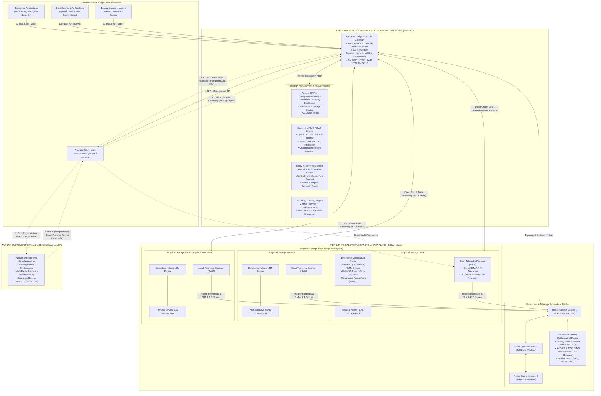

# Aarkam Sovereign Distributed Object & File Storage Platform (`Aarkam.IO`)
### High-Performance, Distributed, Air-Gapped Object Storage Infrastructure for Sovereign Clouds, Defense, Banking & AI Datacenters

[-0F6C3D?style=for-the-badge&logo=dotnet)](https://github.com/melhelbawi/Aarkam.IO)
[](Releases/)
[](https://aarkam.io/)
[](docs/07_APPLICATION_SUPPORT_AND_S3_SDK_GUIDE.md)
[-purple?style=for-the-badge)](docs/05_CTO_SOVEREIGN_ARCHITECTURE_AND_COMPLIANCE_SPEC.md)
[](https://aarkam.io/)

**Official Customer Licensing & Operations Portal (AarkamCP)**: [https://aarkam.io/](https://aarkam.io/)  
**Commercial License**: [Aarkam Commercial Enterprise Sovereign License (ASCEL-v1.0)](LICENSE)  
**Current Production GA Suite**: `V-1.0.0-GA`

---

## 📦 Production GA Distribution Suite

The Aarkam platform is decoupled into four modular, standalone, independently deployable software components located under [`Releases/`](Releases/):

| Tier & Component | Role & Scope | Embedded High-Performance Engine | Standalone Release Artifacts |
| :--- | :--- | :--- | :--- |
| **Tier 2: AarkamIO** | **Sovereign Enterprise Cloud & Ingress Control Plane**<br/>Edge S3 REST Gateway, Web Admin Console, IAM RBAC & Multi-Tenant Namespace Isolation | ASP.NET Core 10 Web Engine & SixFM AI Storage Fabric | [Release Notes](Releases/AarkamIO/V-1.0.0/RELEASE_NOTES.md) • [Installation Guide](Releases/AarkamIO/V-1.0.0/INSTALLATION_GUIDE.md) • [Checksums](Releases/AarkamIO/V-1.0.0/SHA256SUMS.txt) |
| **Tier 1: Rokka** | **Sovereign Distributed Consensus & Storage Engine**<br/>Stateless Raft Quorum Coordinator, Consistent Hash Ring & High-Speed gRPC Data Transit | **Ahmodi**: AVX-512 SIMD Vectorized Cauchy Reed-Solomon Erasure Coding | [Release Notes](Releases/Rokka/V-1.0.0/RELEASE_NOTES.md) • [Installation Guide](Releases/Rokka/V-1.0.0/INSTALLATION_GUIDE.md) • [Checksums](Releases/Rokka/V-1.0.0/SHA256SUMS.txt) |
| **Tier 1: Abodi** | **Autonomous Hardware Telemetry & Node Agent**<br/>Out-of-band kernel S.M.A.R.T. monitoring, NVMe flash wear profiling & ML failure forecasting | **Kdouja**: Unbuffered Direct I/O (`O_DIRECT`) Zero-Copy LSM Storage Engine | [Release Notes](Releases/Abodi/V-1.0.0/RELEASE_NOTES.md) • [Installation Guide](Releases/Abodi/V-1.0.0/INSTALLATION_GUIDE.md) • [Checksums](Releases/Abodi/V-1.0.0/SHA256SUMS.txt) |
| **Management: AM CLI** | **Aarkam Manager (`am` / `am.exe`) Operator Tool**<br/>Single-binary administrative CLI for cluster orchestration, disk evacuation & health automation | Native Core Diagnostics & Cluster Orchestrator | [Release Notes](Releases/Am-Cli/V-1.0.0/RELEASE_NOTES.md) • [Installation Guide](Releases/Am-Cli/V-1.0.0/INSTALLATION_GUIDE.md) • [Checksums](Releases/Am-Cli/V-1.0.0/SHA256SUMS.txt) |

---

## 1. Executive Summary & Sovereign Value Proposition

**Aarkam** is an autonomous, distributed, ultra-high-throughput object storage platform engineered specifically for mission-critical sovereign clouds, national defense installations, core banking networks, smart hospitals, and air-gapped enterprise datacenters. 

Operating with **zero external telemetry egress** and **zero internet runtime dependencies**, Aarkam eliminates reliance on foreign hyperscaler clouds (AWS S3, Google Cloud Storage, Microsoft Azure Blob) and overcomes the scaling, hardware-waste, and licensing limitations of legacy software-defined storage systems (MinIO Enterprise, Ceph, Dell ECS, NetApp).

### The Four Sovereign Value Pillars

```
  ┌──────────────────────────────────────────────────────────────────────────────────────────────────┐
  │                                   AARKAM SOVEREIGN PILLARS                                       │
  ├──────────────────────────────┬──────────────────────────────┬────────────────────────────────────┤
  │    1. DATA SOVEREIGNTY       │   2. 58.3% HARDWARE SAVINGS  │    3. DIRECT NVMe HARDWARE SPEED   │
  │  • 100% Air-Gapped Certified │  • Cauchy Reed-Solomon Math  │  • Kernel Page-Cache Bypass        │
  │  • Zero Telemetry Egress     │  • 1.25x - 1.37x raw footprint│  • In-process Kdouja LSM Engine   │
  │  • NCA ECC & SDAIA Compliant │  • Replaces 3x replication   │  • Zero Inode Exhaustion           │
  ├──────────────────────────────┴──────────────────────────────┴────────────────────────────────────┤
  │                            4. PREDICTIVE PROACTIVE SELF-HEALING                                  │
  │  • Out-of-band Abodi sidecar monitors NVMe flash wear, sector jitter & thermal drift             │
  │  • 72-hour machine-learning runway forecasting migrates data before hardware faults              │
  └──────────────────────────────────────────────────────────────────────────────────────────────────┘
```

1. **Absolute Data Sovereignty & Zero Egress**:
   Aarkam is designed from the silicon layer up to operate indefinitely inside fully isolated, dark-site facilities. Every software package is cryptographically signed, self-contained, and completely free of external dependencies. Compliance is pre-aligned with Saudi National Cybersecurity Authority (**NCA ECC**), Saudi Data & AI Authority (**SDAIA PDPL**), National Data Management Office (**NDMO**), and Saudi Central Bank (**SAMA**) cybersecurity frameworks.

2. **Mathematical Hardware Efficiency (Up to 58.3% Hardware Footprint Cut)**:
   Traditional distributed storage platforms rely on triple replication ($3\times$), demanding $300\text{ TB}$ of raw physical drive capacity to store $100\text{ TB}$ of usable data. Aarkam's embedded **Ahmodi** mathematical engine utilizes vectorized Cauchy Reed-Solomon erasure coding over Galois Field $GF(2^8)$. Storing $100\text{ TB}$ of usable data with Ahmodi `(8+3)` requires only $137.5\text{ TB}$ raw (72.7% storage efficiency), and Archive `(16+4)` requires only $125\text{ TB}$ raw (80% storage efficiency)—saving multi-million SAR/USD capital expenditures in drives, chassis, rack space, power, and cooling.

3. **Direct NVMe Hardware Saturation (Zero Inode Exhaustion)**:
   Storing millions of discrete chunk files on conventional operating system filesystems (ext4, XFS, NTFS) leads to catastrophic inode exhaustion, metadata lock contention, and fragmentation. Storage nodes in Aarkam bypass filesystem overhead by embedding **Kdouja**, an in-process log-structured merge-tree (LSM) persistence engine. Kdouja streams raw data chunks straight to NVMe media utilizing unbuffered Direct I/O (`O_DIRECT`), bypassing the OS page cache entirely and completely avoiding kernel double-buffering.

4. **Autonomous Predictive Self-Healing (Zero 3 AM Emergency Panic)**:
   Enterprise storage traditionally discovers disk degradation only after write timeouts occur, triggering aggressive foreground rebuild storms that crush cluster throughput. Aarkam's **Abodi** daemon continuously analyzes S.M.A.R.T. counters, media wear, read error rates, and kernel SCSI resets. When an anomalous runway (e.g., 72 hours) is forecasted by Abodi's ML models, Rokka gracefully fences the node and migrates surviving chunks in the background while the drive is still healthy, delivering continuous zero-downtime operations.

---

## 2. The Two Production Tier Architecture Explained Deeply

Aarkam decomposes the storage and data management stack into two strictly segregated architectural tiers, cleanly isolating client ingress and security policy from the physical consensus and storage fabric.



---

### Detailed Tier Breakdown

```
┌────────────────────────────────────────────────────────────────────────────────────────────────────────┐
│               TIER 2: SOVEREIGN ENTERPRISE CLOUD, INGRESS & CONTROL PLANE                              │
├────────────────────────────────┬───────────────────────────────────────────────────────────────────────┤
│ Component                      │ AarkamIO (`Releases/AarkamIO/V-1.0.0/`)                                │
│ Primary Role                   │ Perimeter API Gateway, IAM Security, Multi-Tenancy & Management UI    │
│ Target Deployment Scope        │ Dedicated Gateway Hosts or Bastion Frontends fronting the cluster      │
│ Ingress Protocols & Ports      │ S3 REST API: Ports 8080 (HTTP) / 8443 (HTTPS) / 57776                 │
│ Management Interface & Ports   │ Web Admin Console: Ports 5000 (HTTP) / 5001 (HTTPS)                   │
├────────────────────────────────┴───────────────────────────────────────────────────────────────────────┤
│ Core Architectural Subsystems:                                                                         │
│  1. S3 SigV4 Engine: Full AWS Signature Version 4 HMAC-SHA256 authentication pipeline.                 │
│  2. S3 Feature Suite: Multipart Uploads, Object Tagging, Lifecycle Expiration, S3 Object Lock (WORM).  │
│  3. SixFM AI Sovereign Storage Fabric: Embedded Small Language Model (SLM) vector search engine that   │
│     indexes document semantics locally in memory with zero external API calls or data egress.          │
│  4. HSM Key Custody: Client envelope encryption via AES-256-GCM backed by hardware HSM (KMIP/PKCS#11). │
│  5. Multi-Tenant Cryptographic Isolation: Strict tenant bucket namespaces, capacity quotas & rate-limits│
└────────────────────────────────────────────────────────────────────────────────────────────────────────┘

┌────────────────────────────────────────────────────────────────────────────────────────────────────────┐
│               TIER 1: PHYSICAL STORAGE FABRIC & SOVEREIGN DATA PLANE                                   │
├────────────────────────────────┬───────────────────────────────────────────────────────────────────────┤
│ Components                     │ Rokka (`Releases/Rokka/V-1.0.0/`) & Abodi (`Releases/Abodi/V-1.0.0/`)  │
│ Primary Role                   │ Distributed Consensus, Mathematical Erasure Coding & NVMe Direct I/O  │
│ Target Deployment Scope        │ Rokka on 3 or 5 Quorum Consensus Nodes; Abodi on EVERY physical host   │
│ Inter-Cluster Ports            │ Rokka Consensus: Port 9100; Abodi Telemetry: Port 9400 (gRPC / mTLS)  │
├────────────────────────────────┴───────────────────────────────────────────────────────────────────────┤
│ Core Architectural Subsystems:                                                                         │
│  1. Rokka Consensus Coordinator: Stateless Raft distributed state machine governing cluster epochs,   │
│     partition distribution, consistent hash rings, and active node membership.                         │
│  2. Embedded Ahmodi Engine: SIMD AVX-512 & AVX2 vectorized Cauchy Reed-Solomon math over GF(2⁸).       │
│     Computes Cauchy generator matrices where every sub-matrix is non-singular, enabling instant        │
│     Gaussian elimination inversion and 12.5 GB/s/core throughput. Profiles: (4+2), (8+3), (16+4).     │
│  3. Speculative Hedged Reads: Eliminates tail latency. For an (8+3) object, Rokka requests 8 data      │
│     chunks. If any node exhibits I/O jitter, a speculative request is instantly fired to a parity node.│
│     The first 8 chunks to return decode the object, completely flattening P99 tail latency spikes.     │
│  4. Abodi Hardware Sentinel: Autonomous out-of-band daemon polling kernel sysfs/WMI S.M.A.R.T. counters│
│     (Reallocated sectors ID 05, Pending sectors ID 197, NVMe wear %, SCSI bus resets) with 72h ML      │
│     failure forecasting. Degraded drives are drained gracefully without taking the cluster offline.    │
│  5. Embedded Kdouja LSM Engine: In-process Direct I/O (`O_DIRECT`) NVMe bypass packing small chunks     │
│     into multi-GB append-only container segments. Arena memory allocation prevents .NET GC pauses.     │
└────────────────────────────────────────────────────────────────────────────────────────────────────────┘
```

---

## 3. Production Deployment Architectures & Sizing Matrix

Aarkam is officially validated and certified across two enterprise-grade production architectures:

| Architectural Metric | Architecture 1: Enterprise Sovereign Tier | Architecture 2: GovCloud Critical Sovereign Tier |
| :--- | :--- | :--- |
| **Target Workloads** | Core Banking, PACS Hospital Imaging, Telemetry Lakes, AI Pipelines | Public Sector Ministries, National Defense, Central Bank Core Systems |
| **Regulatory Compliance** | ISO 27001, SOC 2 Type II, Local Banking PCI-DSS | Saudi NCA ECC-1:2018, SDAIA PDPL, NDMO, SAMA Cyber Framework |
| **Rokka Consensus Quorum** | **3 Quorum Leaders** (Raft Consensus) | **5 Geo-Distributed Quorum Leaders** (Active-Active Multi-DC) |
| **Physical Storage Nodes** | **8 to 32 Storage Hosts** | **32 to 256+ High-Density Storage Hosts** |
| **Physical Storage Drives** | Up to 256 NVMe / SAS Enterprise SSDs | 1,024 to 4,096+ NVMe / SAS 4Kn Drives |
| **Usable Storage Capacity** | **50 TB to 500 TB** (Scalable to Multi-PB) | **2 Petabytes to Exascale** |
| **Erasure Coding Profile** | **Ahmodi `(8+3)` & Cauchy RS `(8+4)`** | **Ahmodi Archive `(16+4)` & Cauchy RS `(8+4)`** |
| **Mathematical Storage Efficiency** | **72.7% Efficiency** (54.2% Raw Footprint Savings) | **80.0% Efficiency** (58.3% Raw Footprint Savings) |
| **Node Failure Tolerance** | Survives simultaneous loss of **3 complete nodes** | Survives simultaneous loss of **4 complete nodes / datacenters** |
| **Durability Math** | **$99.999999999\%$** (Eleven 9s) | **$99.999999999999\%$** (Fourteen 9s) |
| **AI Semantic Search** | **SixFM SLM Engine Included** (Local Vectors) | **SixFM Full Semantic Fabric with Native Arabic & English NLP** |
| **Identity & Authentication** | OpenID Connect, LDAP, Active Directory, SigV4 | **National SSO & Nafath IAM Integration**, PKCS#11 Smartcards |
| **Geo-Replication** | Dual-Datacenter Active-Active Sync | **Tri-Region Geo-Mesh** (Riyadh / Jeddah / Dammam) |
| **High Availability SLA** | **$99.99\%$ Guaranteed Uptime** | **$99.999\%$ Guaranteed Uptime** with 15-minute SRE response |

---

## 4. End-to-End Activation Through Aarkam Customer Portal (AarkamCP)

In adherence to sovereign defense standards, **license minting tooling is strictly quarantined to Aarkam HQ**. Enterprise license certificates and Genesis ceremony bundles (`.arkbundle`) are generated exclusively via the official **Aarkam Customer Portal** at **[https://aarkam.io/](https://aarkam.io/)**.

Deploying an Aarkam cluster follows a zero-trust, 5-stage sovereign activation ceremony:

```
  ┌──────────────────────────────────────────────────────────────────────────────────────────────────┐
  │                           SOVEREIGN AIR-GAPPED ACTIVATION CEREMONY                               │
  ├──────────────────────────────────────────────────────────────────────────────────────────────────┤
  │                                                                                                  │
  │   [On-Premises Datacenter]                   [Air-Gap Boundary]         [Official Portal]        │
  │                                                                        https://aarkam.io/        │
  │                                                                                                  │
  │   1. Deploy Cluster Services                                                                     │
  │      (AarkamIO, Rokka, Abodi)                                                                    │
  │                 │                                                                                │
  │                 ▼                                                                                │
  │   2. Extract Hardware Fingerprint                                                                │
  │      ARK-FP-A7B2C3D4-E5F6G7H8-...                                                                │
  │                 │                                                                                │
  │                 └───────────────────────── (Secure Media) ──────────────► 3. Register & Bind    │
  │                                                                               Cluster on AarkamCP│
  │                                                                               (Select Tier & Ops)│
  │                                                                                      │           │
  │                                                                                      ▼           │
  │   5. Genesis Sealing Ceremony ◄─────────── (Secure Media) ─────────────── 4. Mint Sealed Genesis │
  │      Cluster locks into Sovereign                                            Bundle (.arkbundle) │
  │      Mode (IsBootstrapped = true)                                                                │
  │      Zero Ongoing Internet Needed                                                                │
  └──────────────────────────────────────────────────────────────────────────────────────────────────┘
```

### Stage 4.1: Deploy Storage Services in Un-Bootstrapped State

Deploy the binaries from `Releases/` onto your nodes. The cluster starts in an unsealed bootstrap mode (`IsBootstrapped = false`), exposing only the genesis administrative endpoints:

```bash
# 1. On EVERY Physical Storage Node: Launch Abodi (with embedded Kdouja LSM engine)
cd Releases/Abodi/V-1.0.0
./Abodi --urls "http://0.0.0.0:9400"

# 2. On Quorum Coordinator Nodes (3 or 5 nodes): Launch Rokka (with embedded Ahmodi)
cd Releases/Rokka/V-1.0.0
./rokka-coordinator --urls "https://0.0.0.0:9100"

# 3. On Gateway Ingress Nodes: Launch AarkamIO (Edge Gateway & Control Plane)
cd Releases/AarkamIO/V-1.0.0
./Aarkam --urls "https://0.0.0.0:5001;http://0.0.0.0:5000"
```

### Stage 4.2: Extract the Deterministic Multi-Factor Hardware Fingerprint

The Aarkam platform embeds an immutable, tamper-resistant `ClusterHardwareProfiler`. It interrogates the physical silicon layer and generates a cryptographic hardware fingerprint across five deterministic factors:
- **Factor 1**: Machine Hostname, Logical Processor Count, and CPU Architecture.
- **Factor 2**: Immutable OS Host UUID (`/etc/machine-id` on Linux, Registry `MachineGuid` on Windows).
- **Factor 3**: Primary Physical Network Interface Controller (NIC) MAC Address.
- **Factor 4**: Derivation via HMAC-SHA256 keyed with the official binary Aarkam Root Public Key.

To view your cluster fingerprint, navigate your browser to:
```text
https://<gateway-node-ip>:5001/genesis
```
*Or query via the standalone operator CLI:*
```bash
./am cluster fingerprint
# Output: ARK-FP-4F8A91C2-E6B3D107-88C49F01
```

### Stage 4.3: Register Cluster & Bind Subscription on AarkamCP ([https://aarkam.io/](https://aarkam.io/))

1. Open your browser and navigate to the official portal: **[https://aarkam.io/](https://aarkam.io/)**.
2. Log in with your enterprise credentials and navigate to:
   ```text
   AarkamCP Portal -> Administration -> Current Subscription -> Cluster Hardware Bindings
   ```
3. Select your contracted production tier (**Enterprise Sovereign** or **GovCloud Critical Sovereign**).
4. Enter your designated **Cluster Code** (e.g., `ARK-PROD-RYD-01`) and paste the **Cluster Hardware Fingerprint** (`ARK-FP-...`).
5. Provision your cryptographically injected enterprise operators (usernames, roles, and salted password hashes). These credentials will be sealed directly into the cryptographic envelope.

### Stage 4.4: Mint the Sovereign Genesis Ceremony Bundle (`.arkbundle`)

Click **Generate Sovereign Genesis Bundle** in the portal. AarkamCP's secure licensing engine executes the following cryptographic operations:
1. Constructs a strongly typed `SovereignLicensePayload` incorporating your tier quotas, authorized nodes, and enabled modules (`AhmodiErasureCoding`, `SixFMVectorSearch`, `DedicatedHsmIsolation`, `NafathIAMIntegration`, etc.).
2. Embeds the injected operator security claims directly into the payload.
3. Cryptographically signs the envelope using RSA-4096 / ECDSA P-384 with the **Aarkam Sovereign Root CA** private key.
4. Generates and downloads the sealed file:
   ```text
   Aarkam-Genesis-ARK-PROD-RYD-01.arkbundle
   ```

### Stage 4.5: Perform the Air-Gapped Genesis Sealing Ceremony

Transfer the `.arkbundle` file into your air-gapped datacenter via approved secure physical media (e.g., hardware-encrypted optical media or defense-approved USB data diodes):

1. Access the web console at `https://<gateway-node-ip>:5001/genesis`.
2. Upload `Aarkam-Genesis-ARK-PROD-RYD-01.arkbundle`.
3. Enter your root administrator passphrase.
4. **Autonomous Cryptographic Verification**:
   - AarkamIO validates the bundle's digital signature against the hardcoded Sovereign Root CA public key.
   - It re-computes the local hardware profile to ensure exact fingerprint matching.
   - It deploys the sealed operator claims into the Kdouja LSM-tree metadata store via Rokka.
   - It transitions the cluster state to `IsBootstrapped = true`, locks all genesis endpoints permanently, and redirects to the secure login interface at `/login`.

> [!IMPORTANT]
> **Zero Egress Verification Guarantee**:  
> Once the `.arkbundle` is sealed, **the cluster is 100% self-sufficient**. It will never attempt an outbound connection to `https://aarkam.io/` or any external IP address. All licensing quotas, cryptographic time envelopes, and feature flags are audited locally inside the sovereign perimeter.

---

## 5. End-to-End Zero-Allocation Data Path

Aarkam is architected to eliminate CPU cache thrashing and memory allocations across the complete read and write lifecycle:

```
  ┌──────────────────────────────────────────────────────────────────────────────────────────────────┐
  │                            END-TO-END ZERO-ALLOCATION WRITE PATH                                 │
  ├──────────────┬──────────────────┬──────────────────┬──────────────────────┬──────────────────────┤
  │ 1. S3 INGEST │ 2. ENVELOPE CRYPT│ 3. CAUCHY MATRIX │ 4. PARALLEL TRANSIT  │ 5. DIRECT NVMe WRITE │
  │ AWS SigV4    │ AES-256-GCM      │ AVX-512 SIMD     │ Parallel gRPC mTLS   │ Kdouja Direct I/O    │
  │ Port 8080/   │ Client/HSM Key   │ GF(2⁸) Kernel    │ Multi-Node Chunk     │ Unbuffered (O_DIRECT)│
  │ Port 8443    │ In-Memory Cipher │ Ahmodi Parity    │ Streaming Fabric     │ Bypass OS Page Cache │
  └──────────────┴──────────────────┴──────────────────┴──────────────────────┴──────────────────────┘
```

1. **Ingress & Authentication**: The client application issues an `S3 PUT` request. AarkamIO validates the AWS SigV4 signature (`AWS4-HMAC-SHA256`) and routes the incoming payload into pre-allocated native memory spans.
2. **Client Envelope Encryption**: If bucket encryption is enabled, the stream is encrypted on the fly via hardware-accelerated AES-256-GCM using keys stored in an on-premises HSM.
3. **Ahmodi Cauchy Reed-Solomon Vector Kernel**: The payload is partitioned into $K$ data blocks. Ahmodi applies an AVX-512 vectorized Cauchy generator matrix over $GF(2^8)$, generating $M$ parity blocks simultaneously at **12.5 GB/s per CPU core**.
4. **Non-Blocking gRPC Transit**: The $K+M$ chunks are concurrently dispatched across the internal cluster fabric to designated storage nodes over high-speed mutual TLS (mTLS) streams.
5. **Kdouja Direct I/O Persistence**: Each storage node receives its chunk and writes it directly to NVMe flash using unbuffered Direct I/O (`O_DIRECT`), committing to the synchronous Write-Ahead Log (WAL) and memory skip-list without kernel page cache intervention.

---

## 6. Using the Aarkam Manager (AM) CLI (`am` / `am.exe`)

The standalone CLI binary `am` (located in [`Releases/Am-Cli/V-1.0.0/`](Releases/Am-Cli/V-1.0.0/)) provides single-binary, deterministic command-line administration for SREs and automation scripts:

```bash
# 1. Inspect live cluster consensus, epoch state, and active leaders
./am cluster status --watch 1s

# 2. Inspect physical hardware health and S.M.A.R.T. status across all nodes
./am disk list

# 3. View Abodi ML failure runway score for a specific NVMe drive
./am abodi score --device /dev/nvme0n1 --format json

# 4. Gracefully drain a degraded disk prior to physical hot-swap
./am disk drain /dev/nvme2n1 --reason "Abodi Predictive S.M.A.R.T. Alert"

# 5. Evacuate an entire storage node for scheduled hardware maintenance
./am node evacuate storage-node-04 --reason "DIMM replacement" --yes

# 6. Run on-host SIMD Galois Field AVX-512 performance benchmark
./am benchmark simd --profile 8+3
```

---

## 7. Application Integration & S3 SDK Verification

Aarkam is a 100% drop-in replacement for AWS S3. It natively supports existing enterprise software, backup platforms, and developer libraries.

### AWS CLI (Standard S3 Client)
```bash
# Configure standard S3 credentials
export AWS_ACCESS_KEY_ID="AKIA_PROD_VAULT_01"
export AWS_SECRET_ACCESS_KEY="SEC_KEY_SOVEREIGN_SECRET_987XYZ"
export AWS_ENDPOINT_URL="https://storage.internal.aarkam:8443"

# Create a sovereign bucket with S3 Object Lock (Compliance WORM enabled)
aws --endpoint-url $AWS_ENDPOINT_URL --no-verify-ssl s3api create-bucket \
    --bucket sovereign-records \
    --object-lock-enabled-for-bucket

# Upload multi-part object
aws --endpoint-url $AWS_ENDPOINT_URL --no-verify-ssl s3 cp dataset.tar.zst s3://sovereign-records/

# Verify bucket inventory
aws --endpoint-url $AWS_ENDPOINT_URL --no-verify-ssl s3 ls s3://sovereign-records/
```

### Python (Boto3)
```python
import boto3
from botocore.client import Config

# Initialize client pointing to local AarkamIO Edge Gateway
s3 = boto3.client(
    's3',
    endpoint_url='https://storage.internal.aarkam:8443',
    aws_access_key_id='AKIA_PROD_VAULT_01',
    aws_secret_access_key='SEC_KEY_SOVEREIGN_SECRET_987XYZ',
    config=Config(signature_version='s3v4', s3={'addressing_style': 'path'}),
    verify=False  # Point to internal enterprise root CA in production
)

# Upload sensitive dataset with server-side encryption metadata
with open("classified_telemetry.parquet", "rb") as data:
    s3.put_object(
        Bucket="sovereign-records",
        Key="telemetry/2026/classified_telemetry.parquet",
        Body=data,
        ServerSideEncryption="AES256"
    )
print("Payload successfully committed to Aarkam Sovereign Fabric.")
```

---

## 8. Official Documentation Suite

For detailed deployment blueprints, network firewall matrices, and hardware sizing guides, consult the [`docs/`](docs/) directory:

| Document | Title & Focus Area | Target Audience |
| :--- | :--- | :--- |
| [`01_COMPREHENSIVE_REQUIREMENTS_MATRIX.md`](docs/01_COMPREHENSIVE_REQUIREMENTS_MATRIX.md) | Node, Cluster, and AarkamIO Hardware & Kernel Specifications | Infrastructure Architects & SREs |
| [`02_PORTS_AND_NETWORK_FIREWALL_MATRIX.md`](docs/02_PORTS_AND_NETWORK_FIREWALL_MATRIX.md) | Network Zones, MTU 9000 Jumbo Frames, Protocols & Firewall Rules (`ufw`/`firewalld`) | Network & Security Engineers |
| [`03_STORAGE_AND_DRIVE_INFRASTRUCTURE_GUIDE.md`](docs/03_STORAGE_AND_DRIVE_INFRASTRUCTURE_GUIDE.md) | NVMe, Enterprise SSD, SAS HDD, 4Kn Sectors & IT-Mode Controller Runbook | Datacenter Operators & Storage Techs |
| [`04_END_TO_END_INSTALLATION_AND_ACTIVATION_SEQUENCE.md`](docs/04_END_TO_END_INSTALLATION_AND_ACTIVATION_SEQUENCE.md) | Complete Deployment, Hardware Fingerprinting & AarkamCP Genesis Activation | Systems Administrators & DevOps |
| [`05_CTO_SOVEREIGN_ARCHITECTURE_AND_COMPLIANCE_SPEC.md`](docs/05_CTO_SOVEREIGN_ARCHITECTURE_AND_COMPLIANCE_SPEC.md) | Durability Math (11 9s), TCO Analysis vs Cloud, and Regulatory Compliance (NDMO/NCA/SAMA) | CTOs, CISOs, Chief Architects |
| [`06_COO_OPERATIONS_DISASTER_RECOVERY_RUNBOOK.md`](docs/06_COO_OPERATIONS_DISASTER_RECOVERY_RUNBOOK.md) | Business Continuity (RPO=0 / RTO<5s), Fault Domains, and Multi-DC DR | COOs, VP Ops, Incident Commanders |
| [`07_APPLICATION_SUPPORT_AND_S3_SDK_GUIDE.md`](docs/07_APPLICATION_SUPPORT_AND_S3_SDK_GUIDE.md) | S3 API SigV4, Multipart Uploads, and SDK Code Samples (Python, Go, C#, Node.js) | Application Developers & DevOps |

---

## 9. Commercial Licensing & Enterprise Support

Aarkam is commercially distributed under the [Aarkam Commercial Enterprise Sovereign License (ASCEL-v1.0)](LICENSE).

- **Official Operations & Customer Licensing Portal**: [https://aarkam.io/](https://aarkam.io/)
- **Technical Documentation & Knowledge Base**: [https://aarkam.io/Docs](https://aarkam.io/Docs)
- **Enterprise Support Portal**: [https://aarkam.io/Administration/TehcnicalSupport](https://aarkam.io/Administration/TehcnicalSupport)
- **Enterprise Sales & Custom Sovereign Deployment**: [enterprise@aarkam.io](mailto:enterprise@aarkam.io)

---
*© 2026 Aarkam Inc. All Rights Reserved. Sovereign Distributed Storage Infrastructure.*
