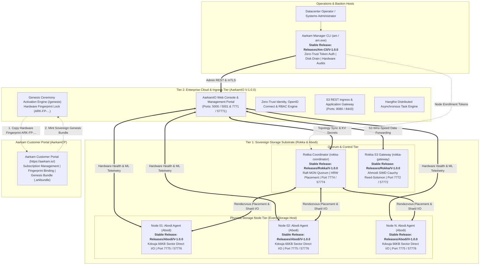

# AarkamIO Sovereign Enterprise Cloud & Control Plane
# Official Production Air-Gapped Installation & Deployment Guide

| Specification | Standard |
| :--- | :--- |
| **Document Identifier** | `ARK-DOC-AARKAMIO-INSTALL-V1.0.0` |
| **Product** | AarkamIO Sovereign Enterprise Cloud & Control Plane |
| **Release Version** | `V-1.0.0-GA (Production Stable)` |
| **Architectural Scope** | Central Control Plane, S3 REST Gateway, Web Console & Sovereign Identity |
| **Target Audience** | Datacenter Storage Architects, Cloud Infrastructure Engineers, Defense Systems Administrators, CISOs |
| **Cybersecurity Standards** | Saudi NCA ECC-2:2024, NCA CSCC-1:2023, FIPS 140-3 Zero-Trust Architecture |
| **Customer Portal (AarkamCP)** | [https://aarkam.io/](https://aarkam.io/) |
| **Target Distribution** | Zero-Egress Air-Gapped Datacenters (Linux x64, Windows Server x64) |

---

## 1. System Overview & Sovereign Tiered Architecture

The **Aarkam Sovereign Storage Platform** (`Aarkam.IO`) is an autonomous, ultra-high-throughput, distributed object storage platform engineered specifically for air-gapped defense grids, sovereign national clouds, banking infrastructures, and mission-critical enterprise datacenters.

The platform architecture is decoupled into **Two Specialized Operational Tiers** alongside a dedicated **Operator Management Plane**:



### 1.1 The Role of Each Component in the Ecosystem

1. **`AarkamIO` (This Release — `Releases/AarkamIO/V-1.0.0`)**:
   - The central **Tier 2 Enterprise Cloud & Control Plane**.
   - Serves the multi-tenant Web Management Console, OpenID Connect SSO/IAM identity subsystem, S3-compatible application ingress gateway, asynchronous Hangfire job pipeline, and the zero-trust Genesis Ceremony activation wizard (`/genesis`).
2. **`Abodi` (`Releases/Abodi/V-1.0.0`)**:
   - The **Storage Node Daemon & Hardware Profiler**.
   - Deployed as a background service on **every physical storage host**. Houses the embedded **Kdouja** PageStore for direct NVMe 66,048-byte sector-aligned Direct I/O (`O_DIRECT`), continuous thermal/SMART monitoring, and predictive Weibull/Holt-Winters drive failure evacuation.
3. **`Rokka` (`Releases/Rokka/V-1.0.0`)**:
   - The **Consensus Coordinator & High-Throughput Storage Gateway**.
   - Deployed on 3 or 5 quorum nodes. Houses `rokka-coordinator` (Raft leader election, dynamic Rendezvous HRW placement, secret KV store) and `rokka-gateway` (line-rate AWS SigV4 S3 gateway embedding **Ahmodi** SIMD Galois field $\text{GF}(2^8)$ Cauchy Reed-Solomon erasure coding and AES-256-GCM encryption).
4. **`AM CLI` (`Releases/Am-Cli/V-1.0.0`)**:
   - The **Aarkam Manager Operator CLI** (`am` / `am.exe`).
   - Installed on operator workstations and bastion servers for direct command-line cluster topology queries, hot-swap disk evacuation (`am disk drain`), and node enrollment token generation.

---

## 2. Comprehensive Requirements Matrix

Before beginning installation, verify that the target infrastructure satisfies every requirement detailed below.

### 2.1 Hardware Requirements

| Subsystem | Minimum Specification (PoC / Edge) | Production Recommendation (Tier 2 Control Plane) | Enterprise High-Throughput Cluster |
| :--- | :--- | :--- | :--- |
| **CPU Architecture** | x86_64 (Intel 64 / AMD64) | x86_64 (Intel Xeon Silver / AMD EPYC 7002+) | x86_64 (Intel Xeon Gold/Platinum / AMD EPYC 9004+) |
| **CPU Core Count** | 4 Physical Cores | 8–16 Physical Cores | 32+ Physical Cores |
| **Vector Extensions** | AVX2, AES-NI | AVX2, BMI2, AES-NI | AVX-512 (F, BW, CD, DQ, VL) or AVX2 with VAES |
| **System Memory (RAM)**| 8 GB ECC DDR4 | 16–32 GB ECC DDR4/DDR5 | 64–128 GB Registered ECC DDR5 |
| **OS Drive Storage** | 50 GB SATA SSD | 100 GB NVMe PCIe 3.0 (RAID 1 mirror) | 200 GB+ Enterprise NVMe PCIe 4.0/5.0 (RAID 1) |
| **Data Partition Free** | 20 GB free space | 100 GB+ dedicated for state, logs & WAL | 500 GB+ dedicated NVMe storage |
| **Network Interface** | 1x 1 GbE | 2x 10 GbE (Bonded LACP / 802.3ad) | 2x 25/100 GbE RoCEv2 (RDMA) |
| **Network MTU** | 1500 bytes | 9000 bytes (Jumbo Frames enabled) | 9000 bytes (Jumbo Frames enabled) |

> [!IMPORTANT]
> **CPU Instruction Set Verification**:
> AarkamIO and Ahmodi utilize hardware-accelerated Galois Field $\text{GF}(2^8)$ matrix math kernels. Verify instruction set availability:
> ```bash
> # On Linux
> lscpu | grep -E 'avx|avx2|avx512|aes'
> ```

---

### 2.2 Storage & Physical Drive Geometry Requirements

For the underlying physical storage nodes running **Abodi** and hosting Kdouja PageStore:
1. **Controller Configuration**: Storage controllers MUST operate in **IT-Mode (Initiator Target / HBA Pass-Through)**. Hardware RAID, write-back caching controllers, and SAN abstraction layers are strictly forbidden because they invalidate Kdouja's direct NVMe sector alignment.
2. **Physical Sector Formatting**: Drives MUST be formatted with native **4Kn (4,096-byte native sector geometry)**. 512e (512-byte emulation) incurs performance penalties during Cauchy chunk direct writing.
3. **PageStore 66,048-Byte Alignment**: Kdouja writes directly to disk in sector-aligned 66,048-byte physical blocks (512-byte header + 64 KB aligned payload) using `O_DIRECT` (Linux) and `FILE_FLAG_NO_BUFFERING` (Windows).

---

### 2.3 Operating System & Software Prerequisites

#### Supported Operating Systems
- **Linux (x86_64)**:
  - Ubuntu Server 22.04 LTS / 24.04 LTS (Kernel 5.15+ or 6.8+)
  - Red Hat Enterprise Linux (RHEL) 8.8+ / 9.2+
  - Rocky Linux 9.x / AlmaLinux 9.x
  - Debian GNU/Linux 12 (Bookworm)
- **Windows Server (x64)**:
  - Windows Server 2022 (Datacenter / Standard)
  - Windows Server 2025
  - Windows 11 Enterprise (Workstation testing and dev only)

#### Required Software Packages & Runtimes

##### On Linux:
Install the essential runtime packages and storage diagnostics utilities:
```bash
# Ubuntu / Debian
sudo apt update && sudo apt install -y \
    aspnetcore-runtime-10.0 \
    liburing2 \
    libaio1 \
    xfsprogs \
    smartmontools \
    nvme-cli \
    jq \
    curl \
    net-tools \
    openssl

# RHEL / Rocky Linux / AlmaLinux 9
sudo dnf install -y \
    aspnetcore-runtime-10.0 \
    liburing \
    libaio \
    xfsprogs \
    smartmontools \
    nvme-cli \
    jq \
    curl \
    iproute \
    openssl
```

> [!NOTE]
> If `.NET 10.0` packages are not yet available in your local air-gapped distro repository, install the official Microsoft .NET 10.0 ASP.NET Core Runtime tarball to `/usr/share/dotnet` and link `/usr/bin/dotnet`.

##### On Windows Server:
- Install the **Microsoft .NET 10.0 ASP.NET Core Runtime (Hosting Bundle)** or .NET 10 SDK.
- PowerShell 5.1 or PowerShell 7+ enabled.

---

### 2.4 Database & Persistence Requirements

AarkamIO utilizes an enterprise persistence layer for cluster metadata, audit logs, and asynchronous Hangfire job states. The following database engines are supported:

| Engine | Minimum Version | Deployment Target | Recommended Connection String Format |
| :--- | :--- | :--- | :--- |
| **Microsoft SQL Server** | 2019 / 2022 | Production Enterprise | `Server=sql.aarkam.internal;Database=AarkamDb;User Id=aarkam_app;Password=<STRONG_PWD>;Encrypt=True;TrustServerCertificate=True;` |
| **PostgreSQL** | 14.x / 16.x | Production Open-Source | `Host=pg.aarkam.internal;Database=AarkamDb;Username=aarkam;Password=<STRONG_PWD>;` |
| **Embedded SQLite WAL** | 3.40+ | Air-Gapped Standalone / Edge | Local write-ahead log database in `/var/lib/aarkam/aarkam.db` (auto-provisioned) |

#### Dedicated Hangfire Database:
AarkamIO executes background telemetry analysis, shard rebalancing, and health audits via Hangfire. Ensure the configured database user possesses permissions to create and manage the Hangfire schema (`CREATE TABLE`, `CREATE SCHEMA`, `SELECT`, `INSERT`, `UPDATE`, `DELETE`).

---

## 3. Kernel & Operating System Tuning (Linux & Windows)

For high-throughput, low-latency concurrent storage workloads, apply the following kernel and OS parameters.

### 3.1 Linux Kernel Tuning (`/etc/sysctl.d/99-aarkam.conf`)

Create `/etc/sysctl.d/99-aarkam.conf` with the following parameters:

```ini
# Maximum open file descriptors
fs.file-max = 2097152

# Socket connection backlog queue depth
net.core.somaxconn = 65535
net.ipv4.tcp_max_syn_backlog = 65535

# TCP Memory Buffers (Min, Default, Max in bytes - up to 64MB for 25GbE+)
net.ipv4.tcp_rmem = 4096 87380 67108864
net.ipv4.tcp_wmem = 4096 65536 67108864
net.core.rmem_max = 67108864
net.core.wmem_max = 67108864

# Network device input queue
net.core.netdev_max_backlog = 250000

# Enable BBR TCP congestion control for high throughput
net.core.default_qdisc = fq
net.ipv4.tcp_congestion_control = bbr

# Reduce swap aggression and balance dirty page writebacks
vm.swappiness = 1
vm.dirty_ratio = 10
vm.dirty_background_ratio = 5

# High-density memory mappings for LSM trees and SQLite WAL
vm.max_map_count = 262144
```

Apply immediately without rebooting:
```bash
sudo sysctl --system
```

### 3.2 Linux Process & User Limits (`/etc/security/limits.d/99-aarkam.conf`)

Create `/etc/security/limits.d/99-aarkam.conf`:

```ini
aarkam    soft    nofile    1048576
aarkam    hard    nofile    1048576
aarkam    soft    nproc     524288
aarkam    hard    nproc     524288
aarkam    soft    memlock   unlimited
aarkam    hard    memlock   unlimited
```

### 3.3 Windows Server Network & Ephemeral Port Tuning

Open PowerShell as Administrator and run:

```powershell
# Expand ephemeral dynamic port range for high concurrent socket reuse
netsh int ipv4 set dynamicport tcp start=1025 num=64511

# Tune TCP parameters for low latency and high bandwidth
Set-NetTCPSetting -SettingName Datacenter -AutoTuningLevelLocal Normal -ScalingHeuristics Disabled
Set-NetTCPSetting -SettingName Datacenter -CongestionProvider CTCP
```

---

## 4. Network Architecture & Firewall Port Matrix

The complete network segmentation matrix across all Aarkam sovereign services is defined below:

| Port | Protocol | Direction | Source | Destination | Service Description | Security / Auth |
| :---: | :---: | :---: | :---: | :---: | :--- | :--- |
| **57771** | TCP | Inbound | Admin / SecOps | AarkamIO | Web Console & Genesis Wizard | HTTPS (TLS 1.3 / AES-256-GCM) |
| **7771** | TCP | Inbound | Internal Bastion | AarkamIO | Web Console HTTP Ingress | HTTP (Redirects to 57771) |
| **5001** | TCP | Inbound | Operators / Web UI | AarkamIO | Standard Web Ingress & Genesis | HTTPS (TLS 1.3) |
| **5000** | TCP | Inbound | Operators | AarkamIO | Standard Web Ingress HTTP | HTTP (Redirects to 5001) |
| **8443** | TCP | Inbound | S3 Clients / Workloads | AarkamIO | S3 REST Application Ingress | TLS 1.3 + AWS SigV4 |
| **8080** | TCP | Inbound | S3 Clients / Workloads | AarkamIO | S3 REST Ingress | HTTP + AWS SigV4 |
| **57774** | TCP | Outbound | AarkamIO | Rokka Coordinator | Raft Cluster Topology & Secret KV | HTTP/2 gRPC mTLS |
| **7774** | TCP | Outbound | AarkamIO | Rokka Coordinator | Internal Consensus Fabric | HTTP/2 gRPC |
| **57772** | TCP | Outbound | AarkamIO | Rokka Gateway | Wire-Speed S3 Forwarding | HTTPS / Streaming TCP |
| **7772** | TCP | Outbound | AarkamIO | Rokka Gateway | High-Speed S3 Forwarding | HTTP / Streaming TCP |
| **57776** | TCP | Outbound | AarkamIO | Abodi Node Agent | Real-Time Diagnostics & SMART | HTTPS / REST JSON |
| **7775** | TCP | Outbound | AarkamIO / Rokka | Abodi Node Agent | Direct Sector Allocation RPC | HTTP/2 gRPC mTLS |
| **9090** | TCP | Inbound | Prometheus / Grafana | All Services | OpenMetrics Telemetry Scrape | Bearer Token HTTP |

### 4.1 Linux Firewall Commands

#### Using UFW (Ubuntu / Debian):
```bash
sudo ufw allow 57771/tcp comment 'AarkamIO Web Console & Genesis HTTPS'
sudo ufw allow 7771/tcp  comment 'AarkamIO Web Console HTTP'
sudo ufw allow 5001/tcp  comment 'AarkamIO Console Ingress HTTPS'
sudo ufw allow 5000/tcp  comment 'AarkamIO Console Ingress HTTP'
sudo ufw allow 8443/tcp  comment 'AarkamIO S3 REST TLS'
sudo ufw allow 8080/tcp  comment 'AarkamIO S3 REST HTTP'
sudo ufw reload
```

#### Using firewalld (RHEL / Rocky / AlmaLinux):
```bash
sudo firewall-cmd --permanent --add-port={57771,7771,5001,5000,8443,8080}/tcp
sudo firewall-cmd --reload
```

### 4.2 Windows Defender Firewall Commands (PowerShell)

```powershell
$ports = @(57771, 7771, 5001, 5000, 8443, 8080)
foreach ($port in $ports) {
    New-NetFirewallRule -DisplayName "AarkamIO-Port-$port" -Direction Inbound -Protocol TCP -LocalPort $port -Action Allow -Profile Any
}
```

---

## 5. End-to-End Cluster Deployment Sequence

Deploy the entire Aarkam sovereign stack in the following exact sequence:

```mermaid
sequenceDiagram
    autonumber
    participant Abodi as 1. Physical Nodes (Abodi V-1.0.0)
    participant Rokka as 2. Quorum Nodes (Rokka V-1.0.0)
    participant AM as 3. Operator Bastion (AM CLI V-1.0.0)
    participant AIO as 4. Gateway Node (AarkamIO V-1.0.0)
    participant CP as 5. AarkamCP (https://aarkam.io/)

    Note over Abodi: Step 1: Deploy Abodi on every storage host
    Abodi->>Abodi: Mount NVMe JBOD drives & init Kdouja PageStore (Port 7775 / 57776)

    Note over Rokka: Step 2: Deploy Rokka on 3 or 5 Quorum Nodes
    Rokka->>Rokka: Elect Raft Leader & start Ahmodi Cauchy Engine (Ports 7774 / 7772)

    Note over AM: Step 3: Run AM CLI to audit cluster state
    AM->>Rokka: Query quorum topology (am cluster status)
    AM->>Abodi: Verify physical NVMe SMART health (am disk list)

    Note over AIO: Step 4: Deploy AarkamIO on Management / Gateway Nodes
    AIO->>AIO: Start Kestrel on 57771 / 5001; Unsealed boot redirects to /genesis
    AIO-->>AM: Display Cluster Hardware Fingerprint (ARK-FP-...)

    Note over CP: Step 5: Genesis Activation Ceremony
    AM->>CP: Connect to https://aarkam.io/ -> Bind Fingerprint (ARK-FP-...)
    CP-->>AM: Mint Sovereign Genesis Ceremony Bundle (.arkbundle)
    AM->>AIO: Upload .arkbundle to https://<node-ip>:57771/genesis
    AIO->>AIO: 8-Layer Anti-Tamper Security Audit & Hash SuperAdmin Password
    AIO->>AIO: Irreversible State Lock: IsBootstrapped = true
    AIO-->>AM: Cluster Sealed! Redirect to /login
```

---

### Step 5.1: Deploy Abodi on Every Physical Storage Host
*Source: `Releases/Abodi/V-1.0.0/`*

On every storage host:
```bash
# Linux
sudo mkdir -p /opt/rokka/abodi
sudo unzip abodi-v1.0.0-linux-x64.zip -d /opt/rokka/abodi
cd /opt/rokka/abodi
sudo chmod +x Abodi install-abodi.sh
sudo ./install-abodi.sh \
  --node-code "NODE-01" \
  --rokka-url "https://rokka-coordinator.rokka.internal:57774" \
  --storage-dir "/var/lib/rokka/storage" \
  --enrollment-token "ET1.<TOKEN>"

# Verify Abodi status
sudo systemctl status rokka-abodi
```

---

### Step 5.2: Deploy Rokka Coordinator & Gateway on Quorum Nodes
*Source: `Releases/Rokka/V-1.0.0/`*

On each quorum node:
```bash
# Linux
sudo mkdir -p /opt/aarkam/rokka
sudo unzip rokka-v1.0.0-linux-x64.zip -d /opt/aarkam/rokka
cd /opt/aarkam/rokka
sudo chmod +x rokka-coordinator rokka-gateway install-rokka.sh
sudo ./install-rokka.sh --start-services

# Verify Rokka status
sudo systemctl status rokka-coordinator
sudo systemctl status rokka-gateway
```

---

### Step 5.3: Deploy AM CLI on Operator Workstations
*Source: `Releases/Am-Cli/V-1.0.0/`*

```bash
# Linux
sudo unzip am-v1.0.0-linux-x64.zip -d /opt/aarkam/am
sudo ln -sf /opt/aarkam/am/am /usr/local/bin/am
chmod +x /usr/local/bin/am

# Verify cluster status
am cluster status
am disk list
```

---

### Step 5.4: Deploy AarkamIO (This Package)

#### Linux Automated Installation:
```bash
# Extract package
sudo mkdir -p /opt/aarkam/aarkamio
sudo unzip aarkamio-v1.0.0-linux-x64.zip -d /opt/aarkam/aarkamio
cd /opt/aarkam/aarkamio
sudo chmod +x aarkamio install-aarkamio.sh

# Run automated production installer
sudo ./install-aarkamio.sh \
  --coordinator-url "https://localhost:57774" \
  --rokka-gateway-url "https://localhost:57772" \
  --abodi-url "https://localhost:57776" \
  --am-cli-path "/usr/local/bin/am" \
  --start-service
```

#### Windows Server Automated Installation (PowerShell Administrator):
```powershell
# Extract package
Expand-Archive -Path .\aarkamio-v1.0.0-win-x64.zip -DestinationPath "C:\Program Files\Aarkam\AarkamIO" -Force
cd "C:\Program Files\Aarkam\AarkamIO"

# Run automated installer
.\install-aarkamio.ps1 `
  -CoordinatorUrl "https://localhost:57774" `
  -GatewayUrl "https://localhost:57772" `
  -AbodiUrl "https://localhost:57776" `
  -AmCliPath "C:\Program Files\Aarkam\AM\am.exe" `
  -StartServices
```

---

## 6. Configuration Deep-Dive (`appsettings.json`)

Review and adjust `appsettings.json` located in `/opt/aarkam/aarkamio/appsettings.json` (or `C:\Program Files\Aarkam\AarkamIO\appsettings.json`):

```json
{
  "Logging": {
    "LogLevel": {
      "Default": "Information",
      "Microsoft.AspNetCore": "Warning"
    }
  },
  "AllowedHosts": "*",
  "ConnectionStrings": {
    "HangfireConnection": "Server=.;Database=AarkamHFDb;Trusted_Connection=True;MultipleActiveResultSets=true;Encrypt=True;TrustServerCertificate=True"
  },
  "AppName": "Aarkam",
  "SerilogSettings": {
    "ApplicationName": "Aarkam.Logging",
    "UseFileSink": true,
    "UseSqlServerSink": false,
    "UseSeqSink": false,
    "SeqUrl": "http://localhost:5341/q/#/",
    "MinimumLevel": "Information"
  },
  "SqlServerConfiguration": {
    "DatabaseName": "AarkamDb",
    "ServerName": ".",
    "IsIntegratedSecurity": true,
    "UserID": "",
    "Password": "",
    "UseEncryption": true,
    "TrustServerCertificate": true
  },
  "JwtTokenOptions": {
    "Issuer": "https://localhost:57771/",
    "Audience": "Aarkam System",
    "AccessTokenSecretKey": "REPLACE_WITH_SECURE_64_CHAR_HEX_SECRET_KEY",
    "RefreshTokenSecretKey": "REPLACE_WITH_SECURE_64_CHAR_HEX_REFRESH_KEY",
    "AccessTokenExpirationInMinutes": 60,
    "RefreshTokenExpirationInMinutes": 120
  },
  "Rokka": {
    "CoordinatorAddress": "https://localhost:57774",
    "CoordinatorUrl": "https://localhost:57774",
    "GatewayUrl": "https://localhost:57772"
  },
  "AmCli": {
    "BinaryPath": "/usr/local/bin/am"
  },
  "Abodi": {
    "ServerUrl": "https://localhost:57776",
    "TelemetryIntervalSeconds": 10,
    "HeartbeatIntervalSeconds": 15
  },
  "Aarkam": {
    "GatewayAddress": "https://localhost:57772",
    "MasterKey": ""
  },
  "Kestrel": {
    "Endpoints": {
      "Https": {
        "Url": "https://0.0.0.0:57771",
        "Protocols": "Http1AndHttp2"
      },
      "Http": {
        "Url": "http://0.0.0.0:7771",
        "Protocols": "Http1"
      }
    }
  }
}
```

---

## 7. The Air-Gapped Genesis Ceremony & Activation Sequence

Because Aarkam ships with zero default passwords and zero cloud telemetry, initial cluster bootstrapping must be sealed through the cryptographic Genesis Ceremony:

### Step 7.1: Retrieve Physical Hardware Fingerprint
1. Open a web browser on an administrative workstation and navigate to:
   ```text
   https://<gateway-node-ip>:57771/genesis
   ```
   *(or `https://<gateway-node-ip>:5001/genesis`)*
2. The browser displays the unsealed node state and generates a unique **Cluster Hardware Fingerprint**:
   ```text
   ARK-FP-A7B8C9D0E1F2-4B3C2A1D0E-9876543210
   ```
3. Copy this token.

---

### Step 7.2: Mint Genesis Ceremony Bundle on AarkamCP
1. Using an internet-connected workstation, log into the official **Aarkam Customer Portal (AarkamCP)**:
   **[https://aarkam.io/](https://aarkam.io/)**
2. In the navigation sidebar, navigate to **Administration -> Current Subscription**:
   `https://aarkam.io/Administration/CurrentSubscription`
3. Click the **Bind Fingerprint** button:
   - Paste your copied `ARK-FP-...` token into the form.
   - Enter your enterprise Cluster Identifier (e.g., `PROD-RIYADH-DC01`).
   - Save the binding.
4. Click **Genesis** to download your digitally signed Genesis Ceremony bundle:
   ```text
   Aarkam-Genesis-PROD-RIYADH-DC01.arkbundle
   ```
   - *Commercial Enterprise Subscriptions* unlock unlimited PB-scale capacity, unlimited storage nodes, and SixFM hardware neural telemetry.
   - *Community / Trial Accounts* receive a bundle constrained to 3 nodes, 5 TB capacity, and standard telemetry.

---

### Step 7.3: Seal the Air-Gapped Cluster
1. Transfer the `.arkbundle` file across your air-gap boundary (e.g., via approved encrypted USB or internal bastion jump host).
2. Return to the local Genesis console:
   ```text
   https://<gateway-node-ip>:57771/genesis
   ```
3. Upload the `.arkbundle` file.
4. Set the initial **SuperAdmin Master Password**:
   - The password is salted with a cryptographically secure 256-bit random nonce and hashed locally using **PBKDF2 SHA-256** (310,000 iterations).
5. Click **Seal & Bootstrap Cluster**:
   - The 8-layer cryptographic anti-tamper security suite validates the bundle signature against Aarkam HQ offline root keys.
   - The cluster permanently and irreversibly locks its state:
     `IsBootstrapped = true`
   - The genesis wizard is permanently disabled and the user is redirected to the secure login console at `/login`.

---

## 8. Operational Verification & Smoke Testing

### 8.1 Verifying Web Console & Identity
Navigate to `https://<gateway-node-ip>:57771/login` and log in with your configured SuperAdmin credentials.
Verify:
- Cluster Health Status: `ONLINE (HEALTHY)`
- Quorum Leader elected via Rokka
- All physical storage nodes reporting active telemetry via Abodi

---

### 8.2 Verifying AWS S3 Client Access (AWS CLI)

Configure standard AWS CLI environment variables:

```bash
export AWS_ACCESS_KEY_ID="ARK_ADMIN_ACCESS_KEY"
export AWS_SECRET_ACCESS_KEY="ARK_ADMIN_SECRET_KEY"
export AWS_ENDPOINT_URL="https://<gateway-node-ip>:8443"

# 1. Create a sovereign storage bucket
aws --endpoint-url $AWS_ENDPOINT_URL --no-verify-ssl s3 mb s3://enterprise-vault

# 2. Upload a test object
echo "Aarkam Sovereign Storage Verification Payload" > smoke-test.txt
aws --endpoint-url $AWS_ENDPOINT_URL --no-verify-ssl s3 cp smoke-test.txt s3://enterprise-vault/

# 3. List objects
aws --endpoint-url $AWS_ENDPOINT_URL --no-verify-ssl s3 ls s3://enterprise-vault/

# 4. Download and verify bit-for-bit integrity
aws --endpoint-url $AWS_ENDPOINT_URL --no-verify-ssl s3 cp s3://enterprise-vault/smoke-test.txt downloaded.txt
diff smoke-test.txt downloaded.txt && echo "BIT-FOR-BIT VERIFICATION PASSED!"
```

---

### 8.3 Python S3 Verification Script (Boto3)

```python
import boto3
from botocore.client import Config

s3 = boto3.client(
    's3',
    endpoint_url='https://<gateway-node-ip>:8443',
    aws_access_key_id='ARK_ADMIN_ACCESS_KEY',
    aws_secret_access_key='ARK_ADMIN_SECRET_KEY',
    config=Config(signature_version='s3v4'),
    verify=False  # Set to True or CA cert path in production with TLS
)

# Create bucket and upload
s3.create_bucket(Bucket='boto3-vault')
s3.put_object(Bucket='boto3-vault', Key='diagnostic.json', Body=b'{"status":"operational"}')

# Read back
response = s3.get_object(Bucket='boto3-vault', Key='diagnostic.json')
print("Retrieved payload:", response['Body'].read().decode('utf-8'))
```

---

## 9. Day-2 Operations, Disaster Recovery & Troubleshooting

### 9.1 Service Management Commands

#### On Linux:
```bash
# Check service health
sudo systemctl status aarkamio

# Restart service
sudo systemctl restart aarkamio

# Inspect live application logs
sudo journalctl -u aarkamio -f --output=cat
```

#### On Windows:
```powershell
# Check service status
Get-Service AarkamIO

# Restart service
Restart-Service AarkamIO

# View Event Log entries
Get-EventLog -LogName Application -Source "Aarkam*" -Newest 20
```

---

### 9.2 Physical Drive Evacuation & Hot-Swap (`am disk drain`)

When Abodi detects an impending drive failure via SMART reallocated sectors or thermal spikes:
1. Run the drain command via AM CLI:
   ```bash
   am disk drain /dev/nvme2n1 --force
   ```
2. Rokka instructs Ahmodi to read parity shards and reconstruct lost Cauchy stripes onto healthy physical drives.
3. Once the drain operation reports `COMPLETED (100%)`, safely pull the physical drive and replace it.

---

### 9.3 Common Troubleshooting Runbook

| Symptom | Probable Cause | Corrective Action |
| :--- | :--- | :--- |
| **Genesis endpoint returns 404** | Cluster already bootstrapped (`IsBootstrapped = true`). | The Genesis wizard permanently self-terminates after initial sealing. Access `/login` instead. |
| **Cannot connect to port 57771** | Firewall blocking port or Kestrel binding issue. | Verify firewall rules (`ufw status`, `netstat -tlpn | grep 57771`). Check `Kestrel:Endpoints` in `appsettings.json`. |
| **Rokka Coordinator connection failed** | Rokka Coordinator service offline or mTLS certificate mismatch. | Check `sudo systemctl status rokka-coordinator`. Verify `Rokka:CoordinatorUrl` in `appsettings.json`. |
| **Abodi node telemetry missing** | Abodi agent offline on target host or network partition. | Check `sudo systemctl status rokka-abodi` on target node. Verify port 7775 / 57776 accessibility. |
| **S3 SignatureDoesNotMatch error** | Clock skew between client host and Aarkam cluster. | Ensure NTP / chrony synchronization across all hosts. AWS SigV4 permits a maximum of 15 minutes clock skew. |

---

## 10. Commercial Licensing & Enterprise Support

Aarkam is licensed under the **Aarkam Commercial Enterprise Sovereign License (ASCEL-v1.0)**.

- **Customer Operations & Licensing Portal**: [https://aarkam.io/](https://aarkam.io/)
- **Technical Support Portal**: [https://aarkam.io/Administration/TehcnicalSupport](https://aarkam.io/Administration/TehcnicalSupport)
- **Enterprise Defense & Sovereign Inquiries**: [enterprise@aarkam.io](mailto:enterprise@aarkam.io)

---
*(c) 2026 Aarkam Inc. All Rights Reserved. Sovereign Distributed Storage Infrastructure.*
