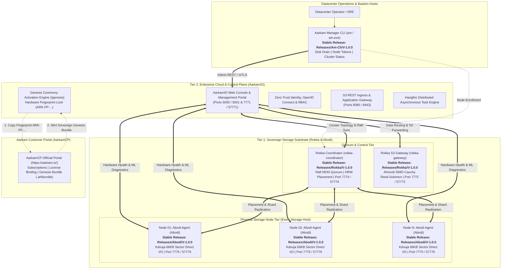

# AarkamIO Sovereign Enterprise Cloud & Control Plane — Release Notes
## Version: V-1.0.0-GA (Official Production General Availability)

| Specification | Standard |
| :--- | :--- |
| **Document Identifier** | `ARK-DOC-AARKAMIO-RELNOTES-V1.0.0` |
| **Product** | AarkamIO Sovereign Enterprise Cloud & Control Plane |
| **Release Version** | `V-1.0.0-GA (Production General Availability)` |
| **Architecture Tier** | Tier 2 Enterprise Cloud, S3 Ingress & Management Control Plane |
| **Release Date** | October 2026 |
| **Compliance Standards** | Saudi NCA ECC-2:2024, NCA CSCC-1:2023, FIPS 140-3 Zero-Trust Architecture |
| **Official Customer Portal (AarkamCP)** | [https://aarkam.io/](https://aarkam.io/) |
| **Target Platforms** | Linux x64 (glibc 2.31+, RHEL 8/9, Ubuntu 22.04/24.04), Windows Server x64 (2022/2025) |

---

## 1. Executive Summary & Ecosystem Unification

**AarkamIO V-1.0.0-GA** represents the official production milestone and crown jewel of the Aarkam Sovereign Object Storage Platform. Operating as the central **Tier 2 Enterprise Cloud & Control Plane**, AarkamIO unifies, orchestrates, and manages the entire Aarkam sovereign ecosystem.

AarkamIO is specifically architected to operate in conjunction with the autonomous, stable standalone components already released across the platform:



---

## 2. Integrated Stable Components Reference

AarkamIO V-1.0.0 builds upon and directly orchestrates the following three core production-stable releases:

| Component | Stable Release Path | Architectural Scope & Role |
| :--- | :--- | :--- |
| **Abodi** | `Releases/Abodi/V-1.0.0` | **Hardware Profiler & Storage Node Daemon**: Runs on every physical storage node. Drives direct NVMe block I/O via embedded Kdouja PageStore (66,048B sector-aligned), continuous SMART/thermal diagnostics, and proactive Weibull/Holt-Winters predictive drive evacuation. |
| **Rokka** | `Releases/Rokka/V-1.0.0` | **Consensus Coordinator & Storage Gateway**: Deployed across quorum nodes. Includes `rokka-coordinator` (Raft distributed consensus, Rendezvous HRW placement, secret KV store) and `rokka-gateway` (streaming AWS SigV4 S3 gateway with embedded Ahmodi SIMD Cauchy Reed-Solomon erasure coding and AES-256-GCM encryption). |
| **AM CLI** | `Releases/Am-Cli/V-1.0.0` | **Aarkam Manager Operator CLI**: Standalone native binary (`am` / `am.exe`) used by datacenter operators for cluster topology inspection, disk hot-swap draining (`am disk drain`), node enrollment token management, and diagnostics. |

---

## 3. Key Capabilities & Innovations in AarkamIO V-1.0.0

### 3.1 Central Sovereign Web Console & Real-Time Visualization
- **Unified Cluster Control**: Modern, responsive management UI delivering real-time topology mapping, active quorum status, physical disk temperature thermals, and Cauchy shard distribution.
- **Node Health Scoring**: Real-time visualization of Abodi health and predictive scores across CPU, Memory, Storage controllers, NVMe namespaces, and network interfaces.
- **Multi-Tenant Organization Management**: Partitioned storage tenants with cryptographic quota boundaries, role-based access control, and dedicated access key lifecycles.

### 3.2 Enterprise S3 REST Ingress & Protocol Engine
- **AWS SigV4 Authenticated Ingress**: Full compliance with AWS Signature Version 4 authentication supporting streaming payloads, presigned URLs, and chunked uploads.
- **PB-Scale Multipart Uploads**: High-concurrency streaming pipeline supporting object uploads up to **5 Terabytes** in size with automatic part validation and parallel Cauchy stripe generation.
- **Regulatory WORM Retention**: Write-Once-Read-Many object retention policies, compliance mode, governance mode, and immutable legal holds.
- **Non-Destructive Versioning**: Soft-delete markers with complete historical version rollback.

### 3.3 Zero-Trust Security & Genesis Ceremony Architecture
- **No Seeded Passwords / Zero Default Backdoors**: The system ships completely unsealed with zero hardcoded credentials or database defaults.
- **Hardware-Locked Genesis Activation**: Binds cluster cryptography to the host server's physical CPU serials, motherboard UUID, and MAC address (`ARK-FP-...`).
- **Air-Gapped Genesis Bundle**: Off-line import of single-use, digitally signed `.arkbundle` provisioned exclusively through the official **Aarkam Customer Portal (AarkamCP)** at **[https://aarkam.io/](https://aarkam.io/)**.
- **Local Master Password Hashing**: SuperAdmin credentials salted and hashed locally using PBKDF2 with SHA-256 (310,000 iterations); cluster state permanently transitions to `IsBootstrapped = true`.

### 3.4 OpenID Connect, OAuth2 & Enterprise IAM
- Integrated OpenIddict server for enterprise single sign-on (SSO), JWT token issuance, and granular policy enforcement.
- Epoch-monotonic tokens preventing replay attacks across air-gapped environments.

### 3.5 Asynchronous Distributed Job Pipeline (Hangfire)
- High-durability background job execution for cluster health auditing, automated shard scrubbing, disk evacuation monitoring, and capacity alerts.

---

## 4. Distribution Package Manifest

The artifacts in `Releases/AarkamIO/V-1.0.0` provide complete standalone multiplatform distributions:

| Artifact Filename | Target Platform | Size | Description |
| :--- | :--- | :---: | :--- |
| **`aarkamio-v1.0.0-linux-x64.zip`** | Linux x64 (RHEL 8/9, Ubuntu 22.04/24.04) | **~26 MB** | Full AarkamIO binaries, launcher `aarkamio`, `install-aarkamio.sh`, `wwwroot/`, `appsettings.json`, `web.config` |
| **`aarkamio-v1.0.0-win-x64.zip`** | Windows Server x64 (2022/2025) | **~26 MB** | Full AarkamIO binaries, `Aarkam.exe`, `install-aarkamio.ps1`, `wwwroot/`, `appsettings.json`, `web.config` |
| **`SHA256SUMS.txt`** | All Platforms | < 1 KB | Cryptographic SHA-256 verification digests |
| **`INSTALLATION_GUIDE.md`** | All Platforms | Text | Comprehensive, deeply detailed installation manual and operational runbook |
| **`RELEASE_NOTES.md`** | All Platforms | Text | Official Release Notes and architecture specification |

---

## 5. Supported AWS S3 API Feature Matrix

| Category | API Action | Implementation & Verification Details |
| :--- | :--- | :--- |
| **Bucket Lifecycle** | `CreateBucket`, `DeleteBucket`, `ListBuckets`, `HeadBucket` | Multi-tenant namespace isolation, strict quota accounting, DNS-compliant bucket names. |
| **Object I/O** | `PutObject`, `GetObject`, `DeleteObject`, `HeadObject` | High-throughput streaming with end-to-end CRC32C and SHA-256 checksum validation. |
| **Multipart Uploads** | `CreateMultipartUpload`, `UploadPart`, `CompleteMultipartUpload`, `AbortMultipartUpload` | Supports objects up to **5 Terabytes** with 10,000 parts (5MB to 5GB per part). |
| **Regulatory WORM** | `PutObjectRetention`, `GetObjectRetention`, `PutObjectLegalHold` | Write-Once-Read-Many regulatory retention with retention date locks. |
| **Object Versioning** | `PutBucketVersioning`, `GetBucketVersioning`, `ListObjectVersions` | Concurrent multi-versioning with cryptographic delete markers. |
| **Presigned URLs** | AWS SigV4 Query String Authentication | Secure, time-limited presigned URLs for client GET and PUT requests without exposing credentials. |

---

## 6. Ports & Network Segmentation Matrix

| Port | Protocol | Direction | Source | Destination | Service / Role | Encryption |
| :---: | :---: | :---: | :---: | :---: | :--- | :--- |
| **57771** | TCP | Inbound | Datacenter Admin / SecOps | AarkamIO | Web Console & Genesis Wizard | HTTPS (TLS 1.3 / AES-256-GCM) |
| **7771** | TCP | Inbound | Internal Bastion | AarkamIO | Web Console Ingress | HTTP (Redirects to 57771) |
| **5001** | TCP | Inbound | Operators / Web UI | AarkamIO | Standard Web Ingress & Genesis | HTTPS (TLS 1.3) |
| **5000** | TCP | Inbound | Operators | AarkamIO | Standard Web Ingress HTTP | HTTP (Redirects to 5001) |
| **8443** | TCP | Inbound | S3 Workloads / SDKs | AarkamIO | S3 REST Application Ingress | TLS 1.3 + AWS SigV4 |
| **8080** | TCP | Inbound | S3 Workloads / SDKs | AarkamIO | S3 REST Ingress | HTTP + AWS SigV4 |
| **57774** | TCP | Outbound | AarkamIO | Rokka Coordinator | Cluster Consensus & HRW Placement | HTTP/2 gRPC mTLS |
| **7774** | TCP | Outbound | AarkamIO | Rokka Coordinator | Internal Consensus Fabric | HTTP/2 gRPC |
| **57772** | TCP | Outbound | AarkamIO | Rokka Gateway | High-Speed S3 Data Routing | HTTPS / Streaming TCP |
| **7772** | TCP | Outbound | AarkamIO | Rokka Gateway | S3 REST Forwarding | HTTP / Streaming TCP |
| **57776** | TCP | Outbound | AarkamIO | Abodi Node Agent | Real-Time Diagnostics & SMART | HTTPS / REST JSON |
| **7775** | TCP | Outbound | AarkamIO / Rokka | Abodi Node Agent | Direct Sector Allocation RPC | HTTP/2 gRPC mTLS |
| **9090** | TCP | Inbound | Prometheus / Grafana | All Services | OpenMetrics Telemetry Scrape | Bearer Token HTTP |

---

## 7. Verification & Cryptographic Checksums

Verify package authenticity using SHA-256:

```bash
# On Linux
sha256sum -c SHA256SUMS.txt

# On Windows (PowerShell)
Get-FileHash -Algorithm SHA256 aarkamio-v1.0.0-win-x64.zip
```

Expected SHA-256 Checksums:
```text
393540ba2746a06cf83f573d61b8194dfe7491def555543355db5b6ac94c2fe6  aarkamio-v1.0.0-linux-x64.zip
ece0c841c17a42b03c782a7f90033a540fad284fb0cc4655935c4bf3399a11fe  aarkamio-v1.0.0-win-x64.zip
```

---
*(c) 2026 Aarkam Inc. All Rights Reserved. Sovereign Distributed Storage Infrastructure.*
