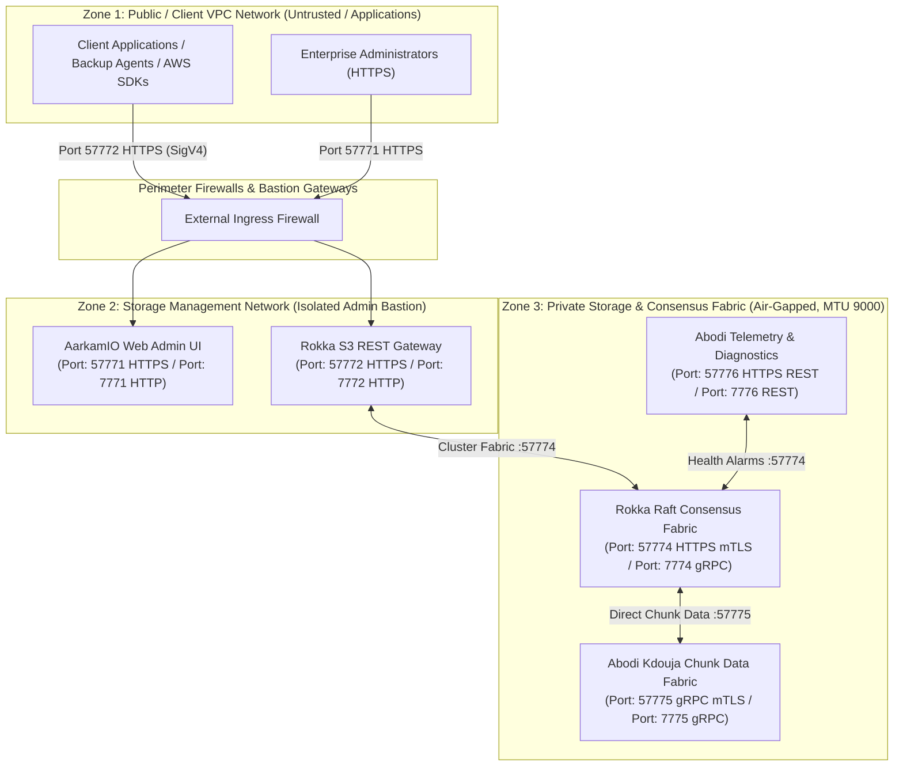

# Aarkam.IO Sovereign Storage Platform — Ports, Networking & Firewall Matrix
## Network Segmentation, Port Specifications & Firewall Rules Runbook
**Target Audience**: Network Engineers, Datacenter Security Teams, Firewall Administrators  
**Customer Portal (AarkamCP)**: [https://aarkam.io/](https://aarkam.io/)

---

## 1. Network Topology & Zoning Architecture

Aarkam enterprise deployments strictly enforce a **Multi-Zone Defense-in-Depth Network Model**:



---

## 2. Complete Ports & Protocol Matrix

> [!NOTE]
> **Why Port 5001 is NOT Used in Production**:  
> In early ASP.NET Core developer templates, ports `5000` (HTTP) and `5001` (HTTPS) were standard local development defaults. For air-gapped sovereign environments, Aarkam standardizes strictly on dedicated port ranges (`777x` series for HTTP/internal gRPC and `5777x` series for TLS 1.3 / mTLS).

| Port | Protocol | Traffic Direction | Source Zone | Destination Zone | Service / Component | Purpose & Description | Security & Encryption |
| :---: | :---: | :---: | :--- | :--- | :--- | :--- | :--- |
| **`57771`** | TCP | Inbound | Admin Bastion / SecOps | AarkamIO Gateway | AarkamIO Web Console | Secure Management UI, REST Admin API, and `/genesis` ceremony wizard | TLS 1.3 / AES-256-GCM / RSA-4096-PSS |
| **`7771`** | TCP | Inbound | Admin Bastion / Internal | AarkamIO Gateway | AarkamIO Web Console | Cleartext Web UI Ingress (Auto-redirects to `57771` in production) | HTTP (Redirect only) |
| **`57772`** | TCP | Inbound | Client Applications / VPC | Rokka Gateway | S3 REST Gateway | Secure S3 REST API (SigV4 authenticated) | TLS 1.3 / AES-256-GCM / SigV4 |
| **`7772`** | TCP | Inbound | Client Applications / VPC | Rokka Gateway | S3 REST Gateway | Standard S3 REST API (SigV4 authenticated) | Cleartext HTTP (Internal VPC) |
| **`57774`** | TCP | Bi-directional | Rokka Quorum Nodes | Rokka Quorum Nodes | Rokka Coordinator | Raft consensus RPC, leader election, and heartbeat synchronization | mTLS / Internal gRPC |
| **`7774`** | TCP | Bi-directional | Rokka Quorum Nodes | Rokka Quorum Nodes | Rokka Coordinator | Internal cluster consensus and topology synchronization | HTTP/2 gRPC |
| **`57775`** | TCP | Bi-directional | Storage Nodes (Abodi) | Rokka Gateway | Abodi (Kdouja) | Cauchy Reed-Solomon EC chunk streaming, replication & re-silvering | Direct TCP Streaming / mTLS |
| **`7775`** | TCP | Intra-Node | Storage Nodes (Abodi) | Storage Nodes (Abodi) | Abodi (Kdouja) | Local intra-node direct block allocation and PageStore transport | Local IPC / gRPC (`127.0.0.1`) |
| **`57776`** | TCP | Bi-directional | Storage Nodes (Abodi) | Rokka Coordinator | Abodi Daemon | Real-time node telemetry, SMART disk alerts, IOPS metrics & health | mTLS / REST JSON |
| **`7776`** | TCP | Localhost | Monitoring / SRE | Storage Nodes (Abodi) | Abodi Daemon | Localhost liveness probe and health status | Cleartext HTTP (`127.0.0.1`) |
| **`9090`** | TCP | Inbound | Monitoring / Prometheus | All Nodes | Telemetry Exporter | Prometheus metrics scrape target (`/metrics`) | Token Authenticated HTTP |

---

## 3. Firewall Configuration Scripts

### 3.1 Ubuntu / Debian (`ufw`) Implementation

#### On Gateway / Management Nodes (Hosting `AarkamIO` & `rokka-gateway`):
```bash
# Reset UFW
sudo ufw --force reset
sudo ufw default deny incoming
sudo ufw default allow outgoing

# Allow SSH from management bastion only
sudo ufw allow from 10.10.10.0/24 to any port 22 proto tcp comment 'Bastion SSH'

# Allow Ingress Web UI and S3 API Gateway
sudo ufw allow from 10.10.10.0/24 to any port 57771 proto tcp comment 'AarkamIO Admin UI HTTPS'
sudo ufw allow from 10.10.10.0/24 to any port 7771  proto tcp comment 'AarkamIO Admin UI HTTP'
sudo ufw allow from 172.16.0.0/12 to any port 57772 proto tcp comment 'Rokka S3 HTTPS'
sudo ufw allow from 172.16.0.0/12 to any port 7772  proto tcp comment 'Rokka S3 HTTP'

# Allow Communication with Storage Fabric (Internal Subnet 192.168.100.0/24)
sudo ufw allow from 192.168.100.0/24 to any port 57774 proto tcp comment 'Rokka Coordinator HTTPS'
sudo ufw allow from 192.168.100.0/24 to any port 7774  proto tcp comment 'Rokka Coordinator gRPC'
sudo ufw allow from 192.168.100.0/24 to any port 57775 proto tcp comment 'Abodi Storage Chunk Fabric'
sudo ufw allow from 192.168.100.0/24 to any port 57776 proto tcp comment 'Abodi Telemetry REST'

sudo ufw enable
```

#### On Storage Nodes (Hosting `Abodi` + `Rokka Coordinator`):
```bash
sudo ufw --force reset
sudo ufw default deny incoming
sudo ufw default allow outgoing

# SSH management
sudo ufw allow from 10.10.10.0/24 to any port 22 proto tcp comment 'Bastion SSH'

# Storage Fabric Ports (Restricted to Storage Subnet 192.168.100.0/24 only)
sudo ufw allow from 192.168.100.0/24 to any port 57774 proto tcp comment 'Rokka Raft HTTPS'
sudo ufw allow from 192.168.100.0/24 to any port 7774  proto tcp comment 'Rokka Raft gRPC'
sudo ufw allow from 192.168.100.0/24 to any port 57775 proto tcp comment 'Abodi Storage Chunk Fabric'
sudo ufw allow from 192.168.100.0/24 to any port 57776 proto tcp comment 'Abodi Telemetry REST'

# Prometheus Metrics Scrape
sudo ufw allow from 10.10.20.50 to any port 9090 proto tcp comment 'Prometheus Server'

sudo ufw enable
```

---

### 3.2 RHEL / Rocky Linux (`firewalld`) Implementation

```bash
# Define dedicated storage zone
sudo firewall-cmd --permanent --new-zone=aarkam-fabric
sudo firewall-cmd --permanent --zone=aarkam-fabric --add-source=192.168.100.0/24

# Add storage fabric ports to private zone
sudo firewall-cmd --permanent --zone=aarkam-fabric --add-port=57774/tcp
sudo firewall-cmd --permanent --zone=aarkam-fabric --add-port=7774/tcp
sudo firewall-cmd --permanent --zone=aarkam-fabric --add-port=57775/tcp
sudo firewall-cmd --permanent --zone=aarkam-fabric --add-port=57776/tcp

# Public / Ingress zone on Gateway Nodes
sudo firewall-cmd --permanent --zone=public --add-port=57771/tcp
sudo firewall-cmd --permanent --zone=public --add-port=7771/tcp
sudo firewall-cmd --permanent --zone=public --add-port=57772/tcp
sudo firewall-cmd --permanent --zone=public --add-port=7772/tcp

sudo firewall-cmd --reload
```

---

## 4. High-Performance MTU 9000 (Jumbo Frames) Configuration

High-throughput Cauchy Reed-Solomon chunk transfers and RDMA require **MTU 9000** across all storage interfaces and Top-of-Rack (ToR) switches.

### Linux Netplan Configuration (`/etc/netplan/01-storage-fabric.yaml`)
```yaml
network:
  version: 2
  renderer: networkd
  ethernets:
    enp4s0f0:
      dhcp4: no
      mtu: 9000
    enp4s0f1:
      dhcp4: no
      mtu: 9000
  bonds:
    bond0:
      interfaces: [enp4s0f0, enp4s0f1]
      addresses: [192.168.100.11/24]
      mtu: 9000
      parameters:
        mode: 802.3ad
        lacp-rate: fast
        mii-monitor-interval: 100
        transmit-hash-policy: layer3+4
```

Apply and verify:
```bash
sudo netplan apply
# Verify MTU 9000 end-to-end ping without fragmentation
ping -M do -s 8972 192.168.100.12
```

---
*(c) 2026 Aarkam Sovereign Object Storage Platform. All Rights Reserved.*
