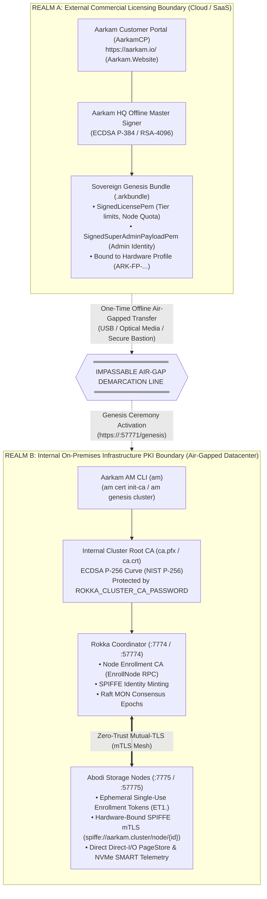
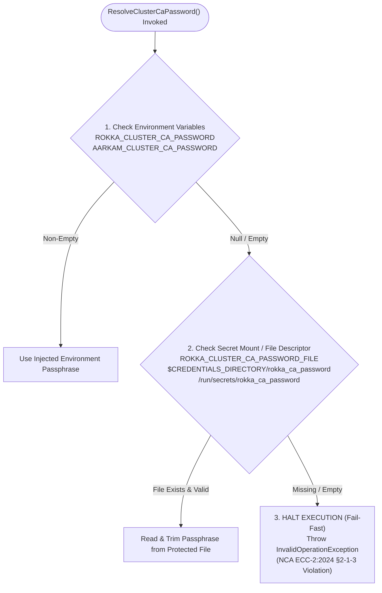

# Aarkam.IO Sovereign Storage Platform — Cryptographic Trust Boundaries & Zero-Trust PKI Specification
## Architectural Separation of External Commercial Licensing vs. Internal Cluster mTLS Key Material
**Document Identifier**: `ARK-SEC-PKI-ZT-008`  
**Classification**: Enterprise Systems Engineering & Zero-Trust Security Standard  
**Cybersecurity Standards**: Saudi NCA ECC-2:2024 (§2-1-3), NCA CSCC-1:2023, FIPS 140-3 Zero-Trust Architecture, NDMO KSA Data Sovereignty  
**Target Audience**: Chief Information Security Officers (CISOs), Enterprise Security Architects, Datacenter Infrastructure Engineers, Compliance Auditors  
**Official Customer Portal (AarkamCP)**: [https://aarkam.io/](https://aarkam.io/)

---

## 1. Executive Summary

In distributed sovereign storage architectures, failure to properly isolate commercial licensing mechanisms from internal inter-node transport cryptography represents an existential security and compliance vulnerability.

A fundamental axiom of **Aarkam Zero-Trust Sovereignty** is the strict, mathematically enforced separation between:
1. **The External Commercial Licensing Realm** (governed by `Aarkam.Website` / AarkamCP), and
2. **The Internal On-Premises Cluster Infrastructure PKI Realm** (governed locally by `AM CLI`, `Rokka Coordinator`, and `Abodi`).

> [!CRITICAL]
> **The Sovereign Cryptographic Isolation Axiom:**  
> Under no circumstances does the external customer portal (`Aarkam.Website`) generate, store, transmit, or possess knowledge of the internal cluster Root Certificate Authority (`ca.pfx`), its encryption passphrase (`ROKKA_CLUSTER_CA_PASSWORD`), or any storage node private keys.  
> If an external cloud portal held access to an on-premises cluster's mutual-TLS (mTLS) Root CA private key, the system would immediately fail Saudi National Cybersecurity Authority (**NCA ECC-2:2024**) air-gapped sovereign compliance.

---

## 2. The Two Isolated Cryptographic Realms



---

## 3. Realm A: External Commercial Licensing Boundary (`Aarkam.Website`)

The external licensing subsystem exists strictly to certify commercial enterprise entitlements and mathematically bind licenses to authorized physical hardware.

### 3.1 Components & Responsibilities
* **`Aarkam.Website` (`AarkamCP`)**: Web portal where organizations register subscriptions, bind hardware fingerprints, and initiate the Genesis Ceremony.
* **Aarkam HQ Master Licensing Key**: An asymmetric cryptographic key pair held exclusively in Aarkam's offline Cold Key Ceremony Vault. The public key is embedded in all Aarkam binaries to verify signatures offline.
* **Hardware Fingerprint (`ARK-FP-...`)**: A deterministic cryptographic digest computed on-premises by the storage node host (synthesizing CPU serials, NVMe WWNs, motherboard UUIDs, and BIOS firmware hashes).

### 3.2 Artifacts Produced by Realm A
1. **Sovereign Enterprise License (`SignedLicensePem`)**:
   - Encodes operational limits: Tier Category (`SAT` Autonomous Substrate vs. `SCT` Enterprise Cloud), maximum storage capacity, maximum node count, and licensed expiration timestamp.
   - Bound immutably to `ARK-FP-...`. If the payload is tampered with or executed on uncertified hardware, verification fails instantly.
2. **Sovereign Genesis Bundle (`.arkbundle`)**:
   - Combines the signed enterprise license with the cryptographically sealed SuperAdmin provisioning payload (`SignedSuperAdminPayloadPem`).
   - Downloaded once by the datacenter administrator from [https://aarkam.io/](https://aarkam.io/) and physically transferred across the air-gap perimeter.

> [!NOTE]
> **Zero Telemetry Back-Channels:**  
> Once the `.arkbundle` is downloaded from `Aarkam.Website`, no outbound network connection from the cluster back to `Aarkam.Website` is ever established, attempted, or required.

---

## 4. Realm B: Internal Infrastructure PKI Boundary (`AM CLI` & `Rokka`)

The internal infrastructure PKI is responsible for zero-trust identity attestation, mutual-TLS (mTLS) session encryption, and command authorization across all physical cluster storage servers.

### 4.1 Components & Responsibilities
* **Local Cluster Root CA (`ca.pfx` / `ca.crt`)**:
  - An **ECDSA P-256** certificate authority generated on-site within the customer's secure network.
  - Generates the authoritative cryptographic root of trust for all intra-cluster gRPC traffic.
* **Aarkam Management CLI (`am`)**:
  - The local operational command-line tool (`Aarkam.AM`).
  - Executes local PKI initialization without external dependencies:
    ```bash
    am cert init-ca --out-dir /etc/rokka/pki --name "Aarkam Sovereign Cluster Root CA"
    ```
* **Rokka Storage Coordinator (`rokka-coordinator`)**:
  - Ingests the local Root CA (`ca.pfx`) on boot.
  - Serves as the dynamic online issuing Certificate Authority (`EnrollNode` gRPC service).
  - Inspects single-use, cryptographically verified enrollment tokens (`ET1.<hex>`) and signs short-lived (24-hour) node certificates containing verified **SPIFFE IDs** (`spiffe://aarkam.cluster/node/{node-code}`).
* **Abodi Storage Node Daemon (`Abodi`)**:
  - Submits a PKCS#10 Certificate Signing Request (CSR) upon boot.
  - Enforces mutual-TLS (mTLS) across all data chunk streaming endpoints (port `57775`) and control plane telemetry (port `57776`).

---

## 5. Security Awareness & Critical Anti-Patterns

### Anti-Pattern 1: Storing Certificate Passwords in `appsettings.json`

```json
/* ❌ CRITICAL SECURITY VIOLATION: NEVER STORE PASSWORDS IN STATIC CONFIG FILES */
{
  "Security": {
    "ClusterCaCertificatePath": "/var/lib/rokka/ca.pfx",
    "ClusterCaPassword": "MySecretPassword123!" 
  }
}
```

#### Why This is a Critical Violation:
1. **NCA ECC-2:2024 (§2-1-3) & NCA CSCC-1:2023 Non-Compliance**: Explicitly forbids storing administrative credentials, cryptographic passphrases, or master keys in unencrypted configuration files.
2. **Version Control Leaks**: Static `.json` configuration files are frequently committed to internal Git repositories, backup snapshots, or container layers, exposing the private key to anyone with read access to the codebase.
3. **Memory and Diagnostic Dumps**: Framework configuration dump endpoints (e.g. ASP.NET Core `/env` or debug endpoints) serialize `IConfiguration` into cleartext JSON responses.

#### The Mandatory Architectural Fix:
Rokka enforces programmatic elimination of `config["Security:ClusterCaPassword"]`. All passphrases must be supplied exclusively through dynamic runtime injection:
```csharp
// Programmatic enforcement in CoordinatorServicesRegistration.cs:
// caPassword is never read from IConfiguration (appsettings.json).
var caPassword = ResolveClusterCaPassword();
```

---

### Anti-Pattern 2: Autonomous Root CA Auto-Generation in Production

```csharp
/* ❌ DANGEROUS PATTERN: SILENT IN-PROCESS FALLBACK GENERATION */
if (File.Exists(caPath)) {
    rootCert = X509CertificateLoader.LoadPkcs12FromFile(caPath, caPassword);
} else {
    // SILENTLY GENERATES A NEW ROOT CA ON REBOOT!
    rootCert = ClusterCertificateAuthority.CreateRootCa("Aarkam Cluster Root CA");
}
```

#### Why This is Catastrophic in Production:
1. **Cluster Partition & Trust Invalidation**: If the local disk volume is temporarily re-mounted or misconfigured, the coordinator restarts with a brand-new self-signed Root CA. Existing storage nodes (`Abodi`) holding certificates signed by the previous CA will immediately reject the coordinator, causing cluster-wide denial of service.
2. **Lack of Provenance**: An enterprise storage cluster must never trust an ephemeral, unaccounted Root CA generated without human operational sign-off or external PKI provenance.

#### The Mandatory Production Fix:
If the Root CA file does not exist at `caPath`, the service **fails fast immediately**:
```csharp
if (!File.Exists(caPath))
{
    throw new FileNotFoundException(
        $"CRITICAL PKI VIOLATION: Cluster CA certificate not found at '{caPath}'. " +
        "In production mode, the Root CA certificate must be explicitly provisioned during cluster genesis (via AM CLI 'am cert init-ca' or enterprise PKI) before starting the coordinator.",
        caPath);
}
```

---

### Anti-Pattern 3: Allowing Empty Passwords Across Environments

Allowing an empty password (`""`) under the assumption of "Development Mode convenience" inevitably leaks into staging and production container deployments.

#### The Mandatory Production Fix:
A non-empty, cryptographically verified passphrase is **strictly mandatory across all environments**. If `ROKKA_CLUSTER_CA_PASSWORD` is not configured, the coordinator refuses to start:
```csharp
if (string.IsNullOrWhiteSpace(password))
{
    throw new InvalidOperationException(
        "CRITICAL SECURITY REQUIREMENT: A valid, non-empty Cluster CA passphrase is required across all environments (NCA ECC-2:2024 §2-1-3 / FIPS 140-3).");
}
```

---

## 6. Zero-Trust Passphrase & Secret Resolution Hierarchy

To maintain maximum deployment flexibility while enforcing strict zero-trust standards, Rokka resolves the Cluster CA passphrase using a strict three-tier resolution hierarchy:



### 6.1 Injection Methods by Platform

| Deployment Platform | Preferred Injection Mechanism | Operational Configuration |
| :--- | :--- | :--- |
| **Linux systemd** | `systemd` Encrypted Credentials | In `/etc/systemd/system/rokka-coordinator.service`:<br/>`SetCredentialEncrypted=rokka_ca_password:<hash>`<br/>(Read automatically via `$CREDENTIALS_DIRECTORY/rokka_ca_password`) |
| **Docker Compose / Swarm** | Docker Secrets / Environment | In `docker-compose.yml`:<br/>`environment:`<br/>&nbsp;&nbsp;`- ROKKA_CLUSTER_CA_PASSWORD=${ROKKA_CLUSTER_CA_PASSWORD}`<br/>Or mounted via `secrets: [ ca_password ]` at `/run/secrets/` |
| **Kubernetes (K8s)** | Secret Volume Mount | Mounted as read-only file (`0400`) at `/etc/rokka/secrets/ca_password` with `ROKKA_CLUSTER_CA_PASSWORD_FILE` pointing to mount path |
| **Windows Server Service** | Windows Protected Registry / Machine Env | Machine-level environment variable set via Administrator PowerShell:<br/>`[Environment]::SetEnvironmentVariable("ROKKA_CLUSTER_CA_PASSWORD", $CaPassword, "Machine")` |

---

## 7. Master Cryptographic Key Reference Matrix

| Key / Secret Identifier | Scope | Governed By | Generation Tool | Format & Storage |
| :--- | :--- | :--- | :--- | :--- |
| **Aarkam Master Licensing Key** | Global Ecosystem | Aarkam HQ Offline Vault | Internal HSM | ECDSA P-384 / RSA-4096 Public Key embedded in all binaries |
| **Hardware Fingerprint (`ARK-FP`)** | Node Hardware | Storage Host Kernel | `ClusterHardwareProfiler` | Deterministic SHA-256 hash of CPU, NVMe WWN, Motherboard UUID |
| **Signed License (`.lic`)** | Cluster Organization | `Aarkam.Website` | AarkamCP Customer Portal | Cryptographic PEM block signed by Aarkam HQ Licensing Key |
| **Genesis Bundle (`.arkbundle`)** | Cluster SuperAdmin | `Aarkam.Website` | AarkamCP Customer Portal | Base64-encoded, digitally signed JSON provisioning envelope |
| **Cluster Root CA (`ca.pfx`)** | Intra-Cluster mTLS | Infrastructure Admin | `am cert init-ca` / AM CLI | PKCS#12 (PFX) encrypted container with POSIX `0600` permissions |
| **`ROKKA_CLUSTER_CA_PASSWORD`** | Intra-Cluster mTLS | Infrastructure Admin | Operator Defined | Injected strictly via environment variable or secret file |
| **`ROKKA_MASTER_KEY`** | Data Plane Storage | Infrastructure Admin | `install-rokka` / CSPRNG | 64-character hexadecimal (32-byte AES-256-GCM envelope key) |
| **`ROKKA_WAL_ENCRYPTION_KEY`** | Metadata WAL Storage | Infrastructure Admin | `install-rokka` / CSPRNG | 64-character hexadecimal (32-byte AES-256-GCM WAL key) |
| **`ROKKA_CLUSTER_SECRET`** | Raft MON Consensus | Infrastructure Admin | `install-rokka` / CSPRNG | Timing-safe HMAC token verifying inter-coordinator Raft RPCs |

---

## 8. Verification & Audit Runbook

To verify that your deployment complies with this zero-trust specification, execute the following audit commands on every Rokka Coordinator host:

```bash
# 1. Verify that NO cleartext passwords exist in configuration files
grep -rni "password" /opt/aarkam/config/ /opt/aarkam/bin/ /etc/rokka/
# [EXPECTED]: 0 matches containing secret passphrases

# 2. Verify that the Cluster CA certificate exists with strict POSIX permissions
ls -la /var/lib/rokka/ca.pfx
# [EXPECTED]: -rw------- (0600) owned strictly by the aarkam service account

# 3. Verify that ROKKA_CLUSTER_CA_PASSWORD is set in the runtime environment
sudo systemctl show rokka-coordinator --property=Environment | grep "ROKKA_CLUSTER_CA_PASSWORD"
# [EXPECTED]: Environment=... ROKKA_CLUSTER_CA_PASSWORD=...

# 4. Verify Coordinator mTLS health probe
curl -k -f https://127.0.0.1:57774/health
# [EXPECTED]: {"status":"Healthy","role":"Rokka Coordinator"}
```

---

Proprietary — Copyright © 2026 Aarkam.IO. All rights reserved.  
Complies with Saudi NCA ECC-2:2024, NCA CSCC-1:2023, and FIPS 140-3 Zero-Trust Architecture.
